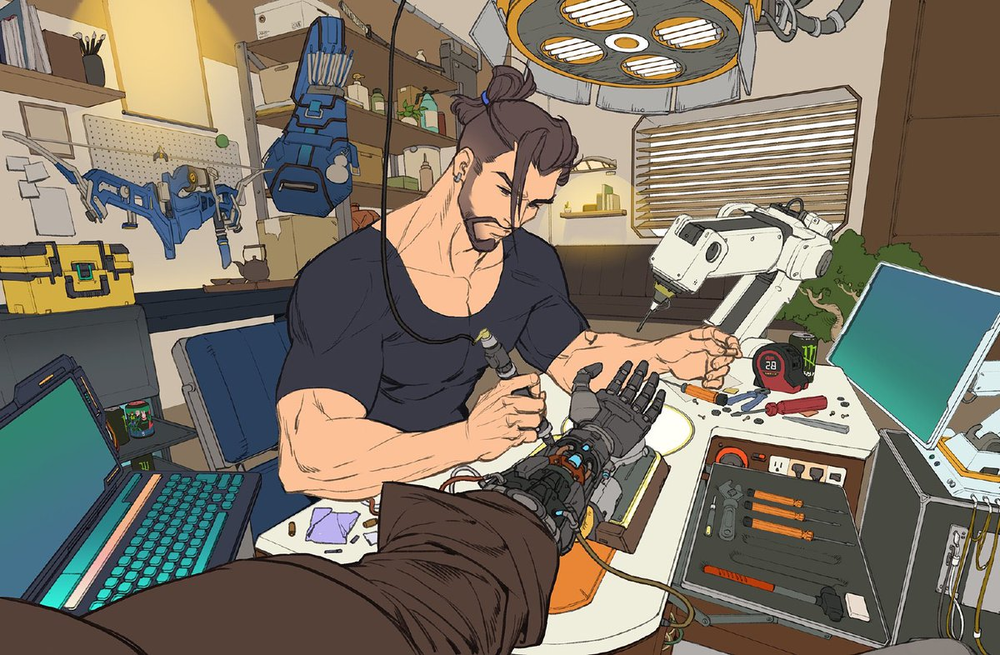

---
hide:
  - toc
---

# Physical AI & Embodied Robotics Engineering

**Learning • Simulation • Deployment**

An open engineering knowledge hub for building intelligent machines that perceive, learn, reason, plan, and act in the physical world.

Explore concepts, try small experiments, and connect them through practical projects. Start with a [suggested learning path](start-here/learning-path.md), or jump into the topic you need.

[Start exploring](start-here/index.md){ .md-button .md-button--primary }
[Build a project](projects/index.md){ .md-button }

## Explore the hub

- **Foundations**

    Mathematics, programming, perception, and learning architectures.

    [Explore foundations](foundations/index.md)

- **Simulation**

    Robot models, OpenUSD scenes, physics, and synthetic data.

    [Build virtual experiments](simulation/index.md)

- **Robot Learning**

    Demonstrations, reinforcement learning, action models, and feedback loops.

    [Explore robot learning](robot-learning/index.md)

- **Deployment**

    Hardware, ROS 2, control, inference, and sim-to-real validation.

    [Connect to hardware](deployment/index.md)

- **Projects**

    Practical briefs connecting perception, simulation, learning, and control.

    [Explore the SO-101 project](projects/so101.md)

- **Resources**

    Documentation, research directions, and community projects.

    [Browse resources](resources/index.md)

## Learn through experiments

Choose a bounded task, test assumptions in simulation, measure behavior, and bring the results into your next iteration. Document failures alongside successes so others can reproduce and extend your work.
